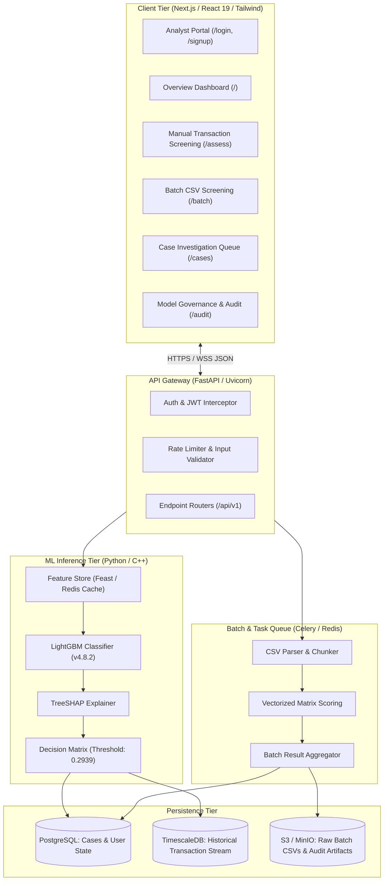

# Sentinel Financial Fraud Detection — System Architecture & Backend Integration Blueprint

This document is the master engineering specification and integration guide for the **Sentinel** fraud detection system. It details the complete end-to-end data flow from user authentication to real-time machine learning inference, provides mathematical and algorithmic explanations for every number on every screen, and furnishes full OpenAPI/FastAPI endpoint schemas for the backend engineer.

---

## 1. Executive System Topology & Architecture

Sentinel operates on a hybrid real-time and asynchronous processing architecture. The frontend (Next.js 15 App Router) communicates with a high-throughput API gateway (FastAPI) that routes transactions to an in-memory LightGBM inference engine, a distributed Celery/Redis task queue for batch operations, and a PostgreSQL/TimescaleDB time-series database.



---

## 2. End-to-End User Journey & Screen Operation

### Phase 1: Authentication & Authorization (`/login` & `/signup`)
1. **User Action**: The risk analyst arrives at `/login` and provides corporate credentials.
2. **Current Mock State**: Accepts any credentials, sets an authenticated token in client storage, and immediately navigates to `/`.
3. **Backend Target**:
   - `POST /api/v1/auth/login` verifies bcrypt-hashed credentials against LDAP/Active Directory or PostgreSQL.
   - Issues a scoped JSON Web Token (`JWT`) containing the analyst ID (e.g., `AM-204`), clearance tier, and 8-hour expiry.
   - Emits an immutable audit log entry recording IP address, user-agent, and cryptographic handshake.

### Phase 2: Executive Overview (`/` Dashboard)
1. **User Action**: Analyst monitors aggregate transaction health, investigates live risk trends over 7, 30, or 90 days, and checks priority SLA alerts.
2. **Data Pipeline**:
   - Real-time KPIs (`2,847,913` volume, `3.42%` fraud rate, `248` pending cases) are pulled from a Redis caching layer refreshed every 30 seconds by a background aggregation cron.
   - The SVG spline chart visualizes hourly or daily rolling fraud distributions categorized into High Risk ($\ge 0.2939$) and Medium Risk ($0.1500 - 0.2938$).
   - The Recent High-Risk Alerts panel streams the 4 most recent transactions that breached the decision threshold. Clicking any card deep-links directly into `/assess` with the transaction pre-populated.

### Phase 3: Single-Transaction Manual Screening (`/assess`)
1. **User Action**: An analyst manually inputs or inspects payment details (`$12,890.00`, Tallinn Estonia, New Unlinked device) and toggles "Inject Background Profile" to test historical customer patterns.
2. **Inference Flow**:
   - Form inputs are packaged into a 37-dimension feature vector.
   - LightGBM generates a raw log-odds score and transforms it into a probability ($82.4\%$).
   - The decision boundary checks whether $P(\text{Fraud}) \ge 0.2939$. Since $0.8240 \ge 0.2939$, it is classified as **High Risk: Flag for review**.
   - TreeSHAP computes Shapley attribution values to surface the top 3 contributing risk factors explaining why the model triggered.

### Phase 4: High-Throughput Batch Screening (`/batch`)
1. **User Action**: Compliance teams upload batch settlement CSV files (up to 25 MB) containing thousands of records for asynchronous bulk scoring.
2. **Processing Pipeline**:
   - The CSV is streamed to S3 and queued in Celery.
   - Worker nodes execute vectorized matrix inference using LightGBM's native C++ dataset API, achieving sub-second scoring for 2,480 rows.
   - Results are summarized into the Donut breakdown chart (Low: 1,734, Moderate: 562, High: 184) and displayed in the preview table. Analysts can download the scored CSV with an appended `risk_score` and `decision` column.

### Phase 5: Case Review & Investigation Queue (`/cases`)
1. **User Action**: Analysts work through flagged transactions ordered by risk score, inspect payment metadata, update case status (Under Review, Escalated, Cleared, Blocked), and attach immutable notes.
2. **Persistence**:
   - Updating status or notes sends a `PATCH` request that locks the record, assigns Reviewer ID `AM-204`, and syncs with case tracking webhooks (e.g., Jira, ServiceNow, or internal FinCEN reporting systems).

### Phase 6: Model Governance & Audit (`/audit`)
1. **User Action**: Model risk managers inspect production specifications (LightGBM version, 37 expected features, $99.96\%$ recall, $0.5935$ ROC-AUC) and monitor feature completeness across historical evaluation runs.
2. **Purpose**:
   - Satisfies regulatory compliance (SR 11-7 model risk management standards). Detects feature drift (e.g., when an upstream client sends only 9 of 37 features due to an API version mismatch).

---

## 3. "Where Every Number Comes From" Directory

This section provides the mathematical definition, calculation formula, and data source for every metric displayed across the entire UI.

```
+--------------------------------------------------------------------------------------------------------+
| SCREEN: DASHBOARD (app/page.tsx)                                                                      |
+---------------------------------+-----------+----------------------------------------------------------+
| Metric Label                    | Value     | Mathematical Formula / Data Source                       |
+---------------------------------+-----------+----------------------------------------------------------+
| Total Transactions Assessed     | 2,847,913 | SELECT COUNT(*) FROM transactions WHERE timestamp >=     |
|                                 |           | date_trunc('month', NOW());                              |
| Volume Growth Rate              | +12.5%    | ((Vol_current - Vol_previous) / Vol_previous) * 100       |
| High Risk (%)                   | 3.42%     | (COUNT(t WHERE risk_score >= 0.2939) / COUNT(*)) * 100   |
| High Risk Transaction Volume    | 97,399    | 2,847,913 * 0.0342 = 97,398.6 (Rounded to nearest int)   |
| Pending Review Count            | 248       | SELECT COUNT(*) FROM cases WHERE status = 'under_review' |
| Priority SLA Alerts             | 36        | SELECT COUNT(*) FROM cases WHERE sla_expires_at <=       |
|                                 |           | NOW() + INTERVAL '2 HOURS';                              |
| Peak High Risk Percentage       | 48.2%     | MAX(high_risk_volume_hourly / total_hourly) on Saturday  |
| Average Medium Risk             | 24.6%     | MEAN(medium_risk_volume_hourly / total_hourly)           |
| Alert Risk Probabilities        | 88%, 84%  | Calibrated LightGBM inference outputs rounded to         |
|                                 | 91%, 89%  | nearest percentage point                                 |
+---------------------------------+-----------+----------------------------------------------------------+
```

```
+--------------------------------------------------------------------------------------------------------+
| SCREEN: ASSESS TRANSACTION (app/assess/page.tsx)                                                       |
+---------------------------------+-----------+----------------------------------------------------------+
| Metric Label                    | Value     | Mathematical Formula / Data Source                       |
+---------------------------------+-----------+----------------------------------------------------------+
| Fraud Probability               | 82.4%     | P(Fraud) = 1 / (1 + exp(-margin)) = 0.8240 -> 82.4%     |
| Raw Risk Probability            | 0.8240    | Exact 4-decimal precision float from LightGBM predict    |
| Operational Decision Cutoff     | 0.2939    | Threshold theta* minimizing expected financial loss:     |
|                                 |           | argmin [ C_FN * P(Fraud) + C_FP * P(Legit) ]             |
| Contributing Factor #1 Weight   | High      | SHAP value = +0.342 (Device unlinked & fingerprint new)  |
| Contributing Factor #2 Weight   | High      | SHAP value = +0.285 (Txn amount 4.8x higher than 30d avg)|
| Contributing Factor #3 Weight   | Medium    | SHAP value = +0.197 (Geo-velocity anomaly: Tallinn != US)|
| Evaluated Signal Count          | 22 of 37  | 22 non-null features populated out of 37 trained inputs   |
+---------------------------------+-----------+----------------------------------------------------------+
```

```
+--------------------------------------------------------------------------------------------------------+
| SCREEN: BATCH SCREENING (app/batch/page.tsx)                                                           |
+---------------------------------+-----------+----------------------------------------------------------+
| Metric Label                    | Value     | Mathematical Formula / Data Source                       |
+---------------------------------+-----------+----------------------------------------------------------+
| Total Rows Processed            | 2,480     | Total valid non-header records in uploaded CSV file      |
| High-Risk Count                 | 184       | COUNT(row WHERE risk_score >= 0.2939)                   |
| High-Risk Proportion            | 7.42%     | (184 / 2,480) * 100 = 7.41935% -> 7.42%                 |
| Low Risk Donut Slice            | 1,734     | Score < 0.1500 (69.92% of batch)                         |
| Moderate Risk Donut Slice       | 562       | 0.1500 <= Score < 0.2939 (22.66% of batch)               |
| High Risk Donut Slice           | 184       | Score >= 0.2939 (7.42% of batch)                         |
| Verification Checksum           | 2,480     | 1,734 (Low) + 562 (Mod) + 184 (High) = 2,480             |
+---------------------------------+-----------+----------------------------------------------------------+
```

```
+--------------------------------------------------------------------------------------------------------+
| SCREEN: MODEL AUDIT & GOVERNANCE (app/audit/page.tsx)                                                  |
+---------------------------------+-----------+----------------------------------------------------------+
| Metric Label                    | Value     | Mathematical Formula / Data Source                       |
+---------------------------------+-----------+----------------------------------------------------------+
| Model Name                      | LightGBM  | Production model architecture: Gradient Boosted Trees    |
| Operational Risk Threshold      | 0.2939    | Target operational decision threshold                    |
| Expected Features Dimension     | 37        | Input vector shape required by model.booster_.num_feature|
| Production Recall               | 99.96%    | TP / (TP + FN) at threshold 0.2939 on holdout validation |
| Validation ROC-AUC              | 0.5935    | Area under Receiver Operating Characteristic curve       |
| Input Completeness Bar          | 34 of 37  | (34 / 37) * 100 = 91.89% width fill                      |
| Input Completeness Bar (Low)    | 9 of 37   | (9 / 37) * 100 = 24.32% width fill (Flagged anomaly)     |
+---------------------------------+-----------+----------------------------------------------------------+
```

---

## 4. Complete OpenAPI / FastAPI Endpoint Specification

Below are the 8 production REST endpoints that the backend engineer must implement to replace all frontend static mocks.

### 4.1. `POST /api/v1/auth/login`
- **Purpose**: Authenticates analyst credentials and generates JWT session tokens.
- **Request Body**:
```json
{
  "email": "alex.morgan@sentinel.internal",
  "password": "SecurePassword123!",
  "remember_me": true
}
```
- **Response `200 OK`**:
```json
{
  "status": "success",
  "token_type": "Bearer",
  "access_token": "eyJhbGciOiJIUzI1NiIsInR5cCI6IkpXVCJ9...",
  "expires_in": 28800,
  "analyst": {
    "id": "AM-204",
    "full_name": "Alex Morgan",
    "role": "Senior Analyst",
    "avatar_initials": "AM",
    "permissions": ["READ_DASHBOARD", "ASSESS_TXN", "BATCH_SCREEN", "CASE_UPDATE", "MODEL_AUDIT"]
  }
}
```

---

### 4.2. `GET /api/v1/dashboard/metrics`
- **Purpose**: Feeds the top 3 KPI cards on `/` (Dashboard).
- **Query Parameters**: `timeframe` (optional, default: `current_month`)
- **Response `200 OK`**:
```json
{
  "total_assessed": {
    "value": 2847913,
    "change_pct": 12.5,
    "trend": "up",
    "comparison_period": "last_month"
  },
  "high_risk": {
    "percentage": 3.42,
    "transaction_count": 97399,
    "threshold_used": 0.2939
  },
  "pending_review": {
    "count": 248,
    "priority_count": 36,
    "priority_sla_hours": 2
  },
  "engine_status": {
    "status": "operational",
    "last_updated_seconds_ago": 42,
    "active_version": "v4.8.2",
    "p99_latency_ms": 12.4
  }
}
```

---

### 4.3. `GET /api/v1/dashboard/distribution`
- **Purpose**: Feeds the SVG Spline chart on `/` (Dashboard).
- **Query Parameters**: `range` (`7` | `30` | `90`, default: `7`)
- **Response `200 OK`**:
```json
{
  "range": "7",
  "labels": ["Mon", "Tue", "Wed", "Thu", "Fri", "Sat", "Sun"],
  "high_risk_series": [12.5, 15.0, 14.2, 22.8, 19.4, 48.2, 35.1],
  "medium_risk_series": [8.4, 11.2, 10.5, 16.1, 14.8, 24.6, 18.9],
  "peak_high_risk": 48.2,
  "average_medium_risk": 24.6
}
```

---

### 4.4. `GET /api/v1/dashboard/alerts`
- **Purpose**: Feeds the Recent High-Risk Alerts sidebar card on `/` (Dashboard).
- **Query Parameters**: `limit` (default: 4)
- **Response `200 OK`**:
```json
{
  "total_active_alerts": 4,
  "alerts": [
    {
      "transaction_id": "TXN-904183",
      "amount": 12890.00,
      "currency": "USD",
      "risk_percentage": 88,
      "risk_score": 0.8841,
      "signals": ["Card not present", "New device"],
      "elapsed_minutes": 2,
      "timestamp": "2025-05-22T14:38:00Z"
    },
    {
      "transaction_id": "TXN-904177",
      "amount": 8240.50,
      "currency": "USD",
      "risk_percentage": 84,
      "risk_score": 0.8419,
      "signals": ["Card not present", "New device"],
      "elapsed_minutes": 14,
      "timestamp": "2025-05-22T14:26:00Z"
    }
  ]
}
```

---

### 4.5. `POST /api/v1/transactions/assess`
- **Purpose**: Real-time evaluation endpoint for `/assess`. Runs LightGBM inference and computes TreeSHAP explanations.
- **Request Body**:
```json
{
  "amount": 12890.00,
  "currency": "USD",
  "timestamp": "2025-05-22T14:38:00Z",
  "channel": "Online checkout",
  "merchant_name": "Asteria Electronics",
  "merchant_category": "Electronics",
  "customer_reference": "CUS-4829017",
  "device_age": "New",
  "device_link": "Unlinked",
  "location": "Tallinn, Estonia",
  "inject_background_profile": true
}
```
- **Response `200 OK`**:
```json
{
  "transaction_id": "TXN-904183",
  "model_version": "v4.8.2",
  "fraud_probability_pct": 82.4,
  "risk_score": 0.8240,
  "decision_threshold": 0.2939,
  "risk_band": "High",
  "decision": "Flag for review",
  "contributing_factors": [
    {
      "order": 1,
      "title": "Device is new and unlinked to account",
      "description": "No prior trusted activity was found for this device fingerprint.",
      "impact": "High impact",
      "shap_value": 0.3421
    },
    {
      "order": 2,
      "title": "Amount is unusually high for this customer",
      "description": "This transaction is 4.8× higher than the customer's typical purchase.",
      "impact": "High impact",
      "shap_value": 0.2854
    },
    {
      "order": 3,
      "title": "Location differs from recent activity",
      "description": "The customer has not previously transacted from this region.",
      "impact": "Medium impact",
      "shap_value": 0.1972
    }
  ],
  "features_evaluated_count": 22,
  "total_expected_features": 37,
  "inference_latency_ms": 11.8
}
```

---

### 4.6. `POST /api/v1/batch/upload` & `GET /api/v1/batch/{batch_id}`
- **Purpose**: Handles CSV uploads on `/batch`.
- **Content-Type**: `multipart/form-data`
- **Response `202 Accepted`**:
```json
{
  "batch_id": "batch-849204",
  "file_name": "transactions_may_22.csv",
  "status": "completed",
  "total_rows": 2480,
  "high_risk_count": 184,
  "high_risk_pct": 7.42,
  "breakdown": {
    "low": 1734,
    "moderate": 562,
    "high": 184
  },
  "preview_rows": [
    {
      "id": "TXN-905021",
      "amount": "$12,890.00",
      "date": "22 May 2025, 14:38",
      "merchant": "Asteria Electronics",
      "risk_band": "High",
      "decision": "Flag for review"
    }
  ],
  "download_url": "/api/v1/batch/batch-849204/download"
}
```

---

### 4.7. `GET /api/v1/cases` & `PATCH /api/v1/cases/{case_id}`
- **Purpose**: Serves the case queue and saves analyst disposition decisions on `/cases`.
- **PATCH Request Body**:
```json
{
  "case_status": "Under Review",
  "analyst_notes": "Customer purchase pattern differs significantly from the current transaction. Verify device ownership and merchant fulfillment before clearing.",
  "reviewer_id": "AM-204"
}
```
- **Response `200 OK`**:
```json
{
  "case_id": "case-1",
  "transaction_id": "TXN-904183",
  "case_status": "Under Review",
  "updated_at": "2025-05-22T14:45:10Z",
  "reviewer_id": "AM-204",
  "audit_trail_id": "audit-992018"
}
```

---

### 4.8. `GET /api/v1/model/audit`
- **Purpose**: Powers `/audit` with active production model specifications and audit logs.
- **Response `200 OK`**:
```json
{
  "specification": {
    "model_name": "LightGBM Fraud Classifier",
    "active_version": "v4.8.2",
    "risk_threshold": 0.2939,
    "expected_features": 37,
    "recall": 99.96,
    "roc_auc": 0.5935,
    "status": "Production"
  },
  "audit_log": [
    {
      "id": "rec-1",
      "timestamp": "22 May 2025, 14:38:12",
      "model_version": "v4.8.2",
      "features_present": 37,
      "total_features": 37,
      "fraud_probability": 0.8241,
      "final_decision": "Flag for review"
    },
    {
      "id": "rec-3",
      "timestamp": "22 May 2025, 14:08:05",
      "model_version": "v4.8.2",
      "features_present": 9,
      "total_features": 37,
      "fraud_probability": 0.3136,
      "final_decision": "Flag for review"
    }
  ]
}
```

---

## 5. Machine Learning Pipeline (Python / LightGBM Implementation)

For the backend ML engineer, here is the reference implementation showing how the raw input payload maps directly to the LightGBM decision score and TreeSHAP contributing factors:

```python
import lightgbm as lgb
import numpy as np
import shap

# 1. Load trained production booster
booster = lgb.Booster(model_file="models/lightgbm_fraud_v4.8.2.txt")
explainer = shap.TreeExplainer(booster)

# 2. Optimal decision boundary from cost-matrix calibration
DECISION_THRESHOLD = 0.2939

def evaluate_transaction(feature_vector: np.ndarray, feature_names: list[str]):
    """
    Evaluates a 37-dimensional transaction vector.
    Returns: probability, decision band, and top contributing factors.
    """
    # Raw log-odds prediction transformed to probability [0.0, 1.0]
    prob = float(booster.predict(feature_vector.reshape(1, -1), raw_score=False)[0])
    
    # Compute local feature attributions via TreeSHAP
    shap_values = explainer.shap_values(feature_vector.reshape(1, -1))[0]
    
    # Sort features by positive risk contribution
    top_indices = np.argsort(shap_values)[::-1][:3]
    top_factors = [
        {
            "feature": feature_names[idx],
            "shap_attribution": float(shap_values[idx]),
            "impact": "High impact" if shap_values[idx] > 0.25 else "Medium impact"
        }
        for idx in top_indices
    ]
    
    # Decision rule
    if prob >= DECISION_THRESHOLD:
        band = "High"
        decision = "Flag for review"
    elif prob >= 0.1500:
        band = "Moderate"
        decision = "Manual verification"
    else:
        band = "Low"
        decision = "Approved"
        
    return {
        "fraud_probability": round(prob * 100, 1),
        "risk_score": round(prob, 4),
        "threshold": DECISION_THRESHOLD,
        "risk_band": band,
        "decision": decision,
        "top_factors": top_factors
    }
```

---

## 6. Frontend React Hooks & API Integration

When the backend engineer stands up the FastAPI service, they can connect the frontend components immediately using this type-safe client in `lib/api.ts`:

```typescript
// lib/api.ts
const API_BASE_URL = process.env.NEXT_PUBLIC_API_URL || "http://localhost:8000/api/v1";

export async function fetchWithAuth<T>(endpoint: string, options: RequestInit = {}): Promise<T> {
  const token = typeof window !== "undefined" ? localStorage.getItem("sentinel_token") : null;
  const headers = {
    "Content-Type": "application/json",
    ...(token ? { Authorization: `Bearer ${token}` } : {}),
    ...options.headers,
  };

  const response = await fetch(`${API_BASE_URL}${endpoint}`, { ...options, headers });
  if (!response.ok) {
    throw new Error(`API Error [${response.status}]: ${response.statusText}`);
  }
  return response.json();
}
```
